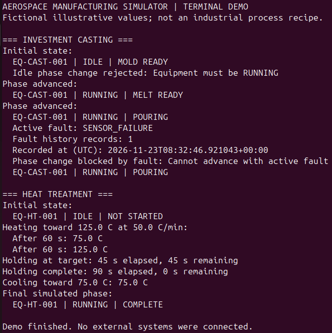
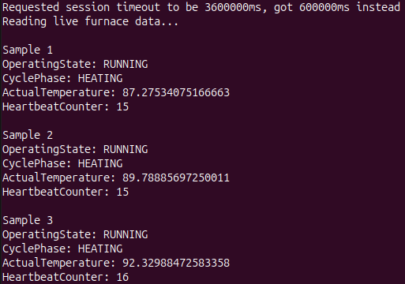
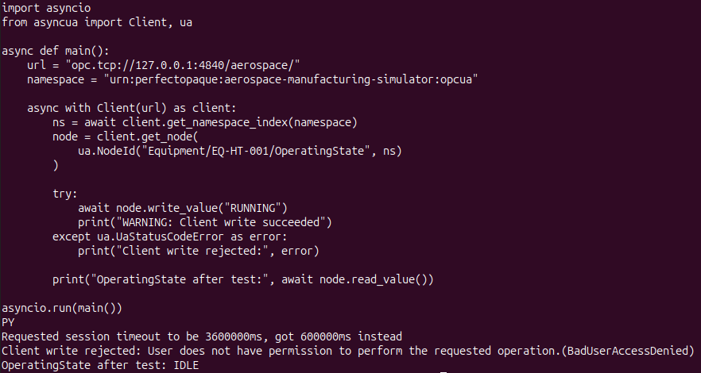

# Aerospace Manufacturing Simulator

[](https://github.com/perfectopaque/aerospace-manufacturing-simulator/actions/workflows/python-tests.yml)

Python | Manufacturing Automation | Cybersecurity | Automated Testing

## About This Project

I'm building a Python simulator to explore how manufacturing equipment operates, how software can monitor it, and how cybersecurity fits into an industrial environment.

This project simulates an aerospace manufacturing facility that produces rocket turbopump housings, which are real components used in rocket propulsion systems.

The manufacturing facility and its operations are fictional, but the project is based on actual manufacturing concepts and processes.

I've also started connecting my Python simulator to industrial communication technology. My first working connection uses OPC UA, a communication standard that allows industrial software and equipment to exchange information.

I built a Python server that shares live information from the simulated heat-treatment furnace, including its temperature and operating status. My next goal is to connect it to an Ignition SCADA system so I can display the furnace information on an industrial dashboard.

This project brings together my experience in precision manufacturing, quality assurance, and cybersecurity while giving me a great opportunity to develop my Python skills.

## What the Simulator Does

The project currently includes two types of manufacturing equipment.

### Investment Casting Equipment (EQ-CAST-001)

Investment casting is a real manufacturing process used to make metal components. My simulator follows five stages of a casting process:

1. Mold Ready
2. Melt Ready
3. Pouring
4. Solidifying
5. Complete

The program tracks which part of the casting process the equipment is in. It also checks whether certain actions are allowed and can record simulated equipment faults.

### Heat-Treatment Furnace (EQ-HT-001)

Heat treatment uses controlled temperatures to change the properties of metal. My furnace simulator can:

- Heat toward a target temperature.
- Hold at that temperature while tracking the time.
- Cool toward a lower target temperature.

I choose the temperatures, heating rates, and time settings to demonstrate how the program works. They are demonstration values, not actual manufacturing specifications or approved aerospace production settings.

### Equipment Faults and Safeguards

I also want to understand what should happen when equipment doesn't behave as expected. My simulator can record faults, keep a history of when they happened, and block certain actions when the equipment isn't ready or the settings are incorrect.

These checks help me practice handling problems in software. They are not safety controls for real machinery.

## See the Simulator in Action

I created a demonstration that walks through the casting process, shows how equipment faults are handled, and demonstrates furnace heating, holding, and cooling.



*The original Python demonstration can run on its own. Instructions for running it are below.*

## Live Furnace Data with OPC UA

My OPC UA server shares changing information from the simulated furnace while it moves through its heating, holding, and cooling cycle.

I tested the connection using a separate Python program to make sure the furnace information was being shared correctly. I could see the temperature changing and check which part of the process the furnace was in.

### Live Furnace Monitoring



*These readings show the two Python programs sharing live information. The heartbeat counter increases periodically to show that the server is still updating.*

### Understanding the Furnace Connection

1. **The furnace simulator runs on my Ubuntu computer.** Other computers cannot connect to it over the network right now. I've intentionally kept everything local while I continue developing and testing the system.

2. **The program shares 15 pieces of furnace information.** These include its temperature, whether it's running, what part of the heating process it's performing, and whether an equipment fault has occurred.

3. **Sometimes information isn't available.** When the simulator doesn't have a particular value, it can mark that information as missing instead of making something up. I'm continuing to test how other programs handle missing information.

4. **Equipment faults and alarms are currently separate.** The simulator can record that something went wrong without automatically activating an alarm. This is how the program works at this stage, and it's something I may improve later.

### Checking That the Connection Is Read-Only

I tested what happens if another Python program tries to change the furnace's operating status through OPC UA. The server rejected the request, and the furnace's operating status stayed the same.



*The server refused the attempted change. This verifies the read-only behavior tested here, not encrypted communication or user authentication.*

### Connection and Security

The connection does not yet encrypt information or verify the identity of a connecting program. Before connecting it to other computers or industrial software, I plan to add those security protections.

This version is intended only for local testing and should not be opened to external networks or used to control real equipment.

## How I Test My Code

The project has 73 automated tests. The original 61 tests check the equipment and manufacturing operations, and 12 newer tests check the OPC UA functions and setup.

These tests help me find mistakes and make sure a new change hasn't broken something that worked before. GitHub Actions runs the full set on Python 3.12 and 3.14 whenever I push changes or open a pull request. The badge at the top of this page links to the test results.

I also use CodeQL to look for possible security issues. Separately, I tested the live OPC UA connection and its read-only behavior using another Python program. Those hands-on checks are separate from the automated test suite.

## Tools I'm Using and Learning

| Tool | What I use it for |
|---|---|
| Python | Writing the equipment simulator and demonstration programs |
| Ubuntu 26.04 LTS | Running my development environment |
| Nano | Writing and editing Python code |
| unittest | Automatically testing my code |
| asyncua | Sharing simulated furnace information through OPC UA |
| Git | Tracking changes to my project |
| GitHub Actions | Running automated tests on Python 3.12 and 3.14 |
| CodeQL | Checking for possible security issues |

My current Ubuntu setup uses Python 3.14.4 and asyncua 2.1.0. I'm exploring Ruff to help catch coding mistakes, and I'm beginning to learn Visual Studio Code (VS Code) as another way to write and understand Python code.

## How to Run the Project

These instructions are for Ubuntu or another Linux system. You'll need Python and Git installed.

### 1. Download the project

```bash
git clone https://github.com/perfectopaque/aerospace-manufacturing-simulator.git
cd aerospace-manufacturing-simulator
```

### 2. Create and activate a Python environment

```bash
python3 -m venv .venv
source .venv/bin/activate
```

### 3. Install the required Python package

```bash
python -m pip install -r requirements.txt
```

### 4. Choose what you'd like to run

To see the equipment's starting information:

```bash
python simulator.py
```

To see the original manufacturing demonstration:

```bash
python demo_simulator.py
```

To start the live OPC UA furnace server:

```bash
python opcua_furnace_server.py
```

The server keeps running until you press Ctrl+C in the terminal. A second OPC UA program on the same computer can read its information while it runs.

To run all the automated tests:

```bash
python -m unittest discover -v
```

## Main Project Files

| File | What it does |
|---|---|
| aero_simulator/equipment.py | Contains equipment behavior, manufacturing stages, and fault handling |
| simulator.py | Shows the starting equipment information |
| demo_simulator.py | Demonstrates casting, furnace operations, and faults |
| opcua_furnace_server.py | Runs the local furnace and shares information through OPC UA |
| test_simulator.py | Tests the original equipment simulator |
| test_opcua_furnace.py | Tests the new OPC UA functions |
| requirements.txt | Lists the extra Python package needed |
| .github/workflows/python-tests.yml | Sets up automated testing on GitHub |
| docs/images/ | Contains the project screenshots |

## Development Progress

### Completed

- [x] Built investment casting and heat-treatment equipment models.
- [x] Added manufacturing stages, temperature calculations, equipment faults, and safeguards.
- [x] Created a demonstration of the original equipment simulator.
- [x] Built a working local OPC UA furnace server with changing readings.
- [x] Confirmed that another Python program can read the data and cannot change the tested operating-status field.
- [x] Added OPC UA automated tests and verified the test suite on two Python versions.
- [x] Documented and published the Python project on GitHub.

### Coming Next

- [ ] Add stronger security before allowing connections over a network.
- [ ] Connect the furnace to Ignition 8.3 SCADA and build a monitoring dashboard.
- [ ] Share investment casting information through OPC UA.
- [ ] Build more automated manufacturing cycles and fault scenarios.
- [ ] Track simulated manufacturing runs, casting lots, and heat-treatment batches.
- [ ] Add production and quality records, historical data, and approval steps.
- [ ] Explore Wazuh for cybersecurity monitoring.
- [ ] Bring these pieces together in a larger demonstration.

## Why This Project Matters to Me

I've worked with manufacturing equipment and quality processes, and I've seen why reliable information and careful decision-making matter. Building this simulator lets me explore how software could support those same goals and how cybersecurity fits into the picture.

I'm learning one step at a time, documenting my progress, and testing new features as I go.

## Connection Details for Developers

For anyone who wants to try the local OPC UA connection, the server uses these settings:

```text
Server address:  opc.tcp://127.0.0.1:4840/aerospace/
Namespace:       urn:perfectopaque:aerospace-manufacturing-simulator:opcua
Example data ID: Equipment/EQ-HT-001/ActualTemperature
Security mode:   NoSecurity
```

The Python source code shows how the furnace information is organized and shared. The server settings above are intended for local development only.

## Connect With Me

GitHub: [perfectopaque](https://github.com/perfectopaque)

LinkedIn: [Tracey Chaney](https://www.linkedin.com/in/tracey-chaney)

*Thanks for checking out my project!*
